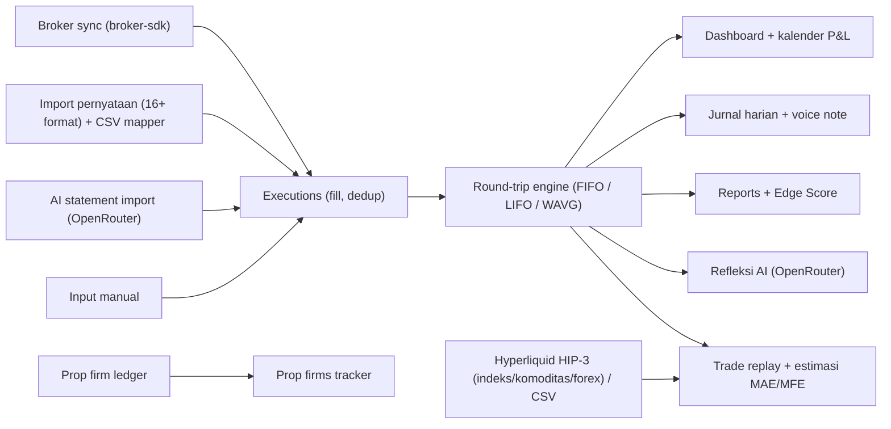

# 02 — Arsitektur sistem

## Stack teknologi (mengikuti upstream)

| Lapisan      | Teknologi                                                          |
| ------------ | ------------------------------------------------------------------ |
| Framework    | Next.js 15 (App Router), React 19, TypeScript                      |
| Styling      | Tailwind CSS 4, Radix UI, lucide-react                             |
| Database     | SQLite via `better-sqlite3` + Drizzle ORM                          |
| Mesin domain | `@luxalgo/journal-core` (round-trip, metrik, kalender, Edge Score) |
| Importir     | `@luxalgo/journal-importers` (16+ format pernyataan, CSV mapper)   |
| Broker sync  | `@luxalgo/broker-sdk` 0.6.0 (koneksi read-only)                    |
| Chart        | `@luxalgo/vela` (chart trade + replay), ECharts & Recharts         |
| Tabel        | TanStack Table 9                                                   |
| AI           | Vercel AI SDK 7 + `@ai-sdk/openai-compatible` → **OpenRouter**     |
| Tulisan      | react-markdown + remark-gfm                                        |
| Export PDF   | pdf-lib + fontkit                                                  |
| Build        | pnpm 11.0.8, Node.js 22+                                           |

Persyaratan lingkungan identik dengan upstream: **Node 22+** dan **pnpm 11.0.8**.

## Struktur monorepo

```
trade-jurnal/
├── apps/web/                 # Aplikasi Next.js (UI + API routes + DB)
│   ├── src/app/              # Halaman & route handler
│   │   ├── api/              # Endpoint REST (accounts, trades, import, ai, ...)
│   │   ├── (dashboard)       # Dashboard, calendar, reports, trades, journal, ...
│   │   ├── login/            # Halaman login (BARU: username + password)
│   │   └── register/         # Halaman registrasi (BARU)
│   ├── src/components/       # Komponen UI (rebranding nama & logo)
│   ├── src/db/               # Skema Drizzle + bootstrap migrasi
│   ├── src/lib/              # Utilitas klien & domain ringan
│   └── src/server/           # auth, ai, crypto, settings, sync, importer server
├── packages/core/            # Mesin murni tanpa IO (@luxalgo/journal-core)
├── packages/importers/       # Parser pernyataan (@luxalgo/journal-importers)
├── docs/                     # Dokumentasi proyek ini
└── docker-compose.yml
```

## Alur data utama (dipertahankan dari upstream)



**Inti sistem tetap satu primitive:** _execution_ (fill). Semua permukaan aplikasi membaca dari round-trip yang dibangun dari fill.

## Desain multi-tenancy (perubahan utama)

Upstream adalah aplikasi **single-user** dengan satu file `journal.db`. Implementasi akhir memakai **satu file SQLite per pengguna**:

1. **Database global** (`data/journal.db`) berisi `users`, `sessions`, `login_attempts`, `ai_usage`, `models`, `global_settings`.
2. **Database per pengguna** (`data/users/<id>.db`) berisi seluruh skema jurnal upstream, identik tanpa perubahan query.
3. **Konteks tenant per request:** session cookie → `userId` → `AsyncLocalStorage` → proxy `db` yang mengarahkan semua query ke file pengguna tersebut.
4. **Isolasi mutlak:** klien tidak pernah mengirim `userId`; tidak ada query yang bisa lupa menyaring kepemilikan karena tiap akun memang memiliki file terpisah.
5. Rincian skema ada di [`07-model-data.md`](07-model-data.md).

### Alternatif yang dipertimbangkan

- **Kolom `owner_id` pada satu database bersama** (rencana awal): lebih sedikit file, tetapi setiap query harus disaring manual; risiko kebocoran data lebih tinggi.
- **Service terpisah per tenant:** berat untuk kebutuhan ini.

### Alur request

```
Browser
  → cookie session (httpOnly, signed)
  → middleware: validasi format cookie, redirect /login bila perlu
  → route handler: resolve userId dari session (DB)
  → runAsUser(userId): proxy db mengarah ke database pengguna tersebut
  → response JSON (Cache-Control: private, no-store)
```

Halaman dan endpoint bersifat privat secara default. Hanya `/login`, `/register`, dan aset statis yang publik.

## Rebranding

- Metadata, judul, header, sidebar, footer, dan teks "Powered by" diganti ke **Trade Jurnal by Artian Capital Group**.
- Komponen logo `LuxAlgoMark` diganti mark Artian Capital Group; tautan ke GitHub upstream tetap ada di footer sebagai atribusi (lihat [`09-deployment-dan-legalitas.md`](09-deployment-dan-legalitas.md)).
- Nama paket npm internal (`@luxalgo/journal-core`, dll.) **tetap dipakai** karena merupakan nama paket teknis; tidak mengubah merek di UI.
